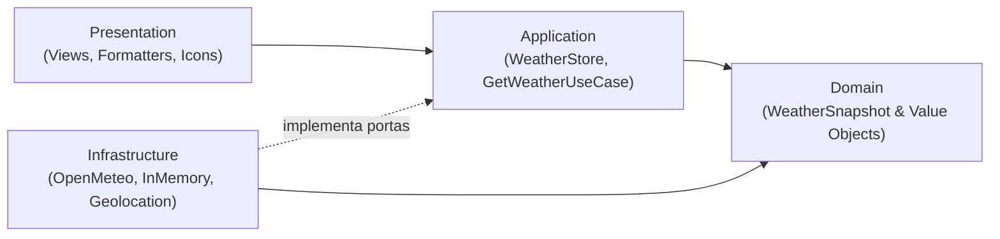

# Clima — Weather App (Bento Grid)

Aplicação web de previsão do tempo construída com **HTML, CSS e JavaScript nativos (ES Modules, zero build e zero frameworks)**, unindo estética **Bento Grid + Glassmorphism** inspirada em interfaces da Apple e Linear com **Domain-Driven Design (DDD)**, **Linguagem Ubíqua** e **Arquitetura Limpa**.

---

## Visão Geral

O projeto foi desenhado em torno de três pilares:

1. **Fidelidade visual sem quebras** — grade Bento responsiva com Glassmorphism sutil, tipografia tabular (`tabular-nums`), temas atmosféricos dinâmicos e skeleton screens que preservam exatamente a proporção dos blocos (CLS = 0).
2. **Plataforma Web em primeiro lugar** — código limpo e semântico que aproveita recursos nativos do navegador em vez de reimplementá-los com bibliotecas externas.
3. **Arquitetura Limpa & DDD** — regras de negócio e invariantes físicas isoladas na camada de domínio, com código e conceitos ubíquos em inglês e interface 100% em português (`pt-BR`).

---

## Funcionalidades

- **Cabeçalho (Top Bar)**
  - Campo de busca em formato pílula com consulta global de cidades (sem necessidade de API key).
  - Botão de geolocalização atual usando a API nativa `navigator.geolocation`.
  - Seletor rápido `°C / °F` com persistência em `localStorage` e atualização instantânea sem recarregar dados.
- **Temas Atmosféricos Dinâmicos**
  - O fundo da página e a cor de destaque transitam suavemente conforme a condição climática atual (`sunny`, `rainy`, `cloudy`).
- **8 Blocos do Bento Grid**
  1. **Card Principal (Hero)**: cidade, região/país, data completa no fuso da localidade, badge `"Agora"`, temperatura em escala fluida (`clamp`), descrição da condição e ícone SVG minimalista animado.
  2. **Previsão Horária**: próximas 8 horas no fuso horário da cidade consultada, em sub-cards com rolagem horizontal suave (`scroll-snap`).
  3. **Sensação Térmica**: valor convertido para a unidade ativa + frase contextual derivada de regra de domínio (`±2 °C`).
  4. **Umidade**: percentual e barra indicadora preenchida na cor do tema.
  5. **Vento**: velocidade em `km/h`, ponto cardeal com ângulo e bússola SVG cuja agulha rotaciona dinamicamente.
  6. **Índice UV**: valor atual, classificação de risco (`Baixo` a `Extremo`), barra proporcional e pico previsto do dia (`Máx. hoje`).
  7. **Previsão de 5 Dias**: lista com divisórias sutis, gradiente térmico posicional compartilhado na escala semanal e marcador da temperatura atual na linha de `"Hoje"`.
  8. **Ciclo Solar**: arco tracejado em SVG com posição real do sol entre nascer e pôr do sol e indicador discreto para fases noturnas (`Antes do amanhecer` / `Após o pôr do sol`).
- **Estados de Interface**
  - **Skeleton Loading** pulsante mantendo a anatomia e altura de cada bloco do grid.
  - **Tratamento de Erros**: avisos discretos na Top Bar quando já há dados na tela e estado de erro com ação `"Tentar novamente"` em falhas no carregamento inicial.

---

## Design System e Responsividade

### Camadas CSS (`@layer`)

Os estilos são orquestrados em `styles/main.css` com especificidade previsível:

```css
@layer reset, tokens, themes, layout, components, states;
```

### Tokens e Temas Dinâmicos

| Tema (`data-theme`) | Condições associadas | Gradiente de fundo | Cor de destaque |
| --- | --- | --- | --- |
| `sunny` | `clear`, `partly-cloudy` | `#0f172a` → `#1e293b` | `#fbbf24` (âmbar dourado) |
| `rainy` | `rain`, `storm` | `#090d16` → `#172554` | `#38bdf8` (ciano elétrico) |
| `cloudy` | `cloudy` | `#111827` → `#374151` | `#cbd5e1` (cinza-prata) |

- **Superfície Glassmorphism**: `rgba(255, 255, 255, 0.06)`, `backdrop-filter: blur(16px)`, borda `1px solid rgba(255, 255, 255, 0.12)` e brilho interno superior `inset 0 1px 0 rgba(255, 255, 255, 0.15)`.
- **Geometria**: `border-radius: 24px` nos cards principais, `16px` nos sub-cards internos e `gap: 20px` uniforme.
- **Tipografia**: `Inter` com `font-variant-numeric: tabular-nums` em temperaturas, horários e métricas.

### Breakpoints do Bento Grid

| Faixa | Colunas | Comportamento |
| --- | --- | --- |
| **Desktop (`> 900px`)** | 4 colunas | Hero `2×3` à esquerda; Horária `2×1` + 4 métricas `1×1` à direita; 5 Dias `2×1` e Ciclo Solar `2×1` na base |
| **Tablet (`520px – 900px`)** | 2 colunas | Hero e Horária em largura total; métricas 2 por linha; 5 Dias e Ciclo Solar empilhados |
| **Mobile (`< 520px`)** | 1 coluna | Todos os blocos empilhados mantendo espaçamento, arredondamento e prevenção contra overflow (`minmax(0, 1fr)` e `min-width: 0`) |

---

## Arquitetura Limpa e DDD

O projeto é modelado a partir do domínio no centro e segue a **Regra da Dependência**: os `import`s de código apontam apenas das camadas externas (`Presentation` e `Infrastructure`) para as internas (`Application` e `Domain`), mantendo o domínio isolado de DOM, CSS, `fetch` ou formatos de APIs externas:



### Glossário da Linguagem Ubíqua (`src/domain/`)

| Conceito | Tipo | Responsabilidade |
| --- | --- | --- |
| `WeatherSnapshot` | Aggregate Root | Consolida localização, clima atual, previsão horária, previsão de 5 dias e ciclo solar; calcula `atmosphericTheme`, `thermalSensation`, `dailyTemperatureBounds`, `getDailyRangeRatio()` e `getCurrentTemperatureRatio()`. |
| `Temperature` | Value Object | Encapsula valor em Celsius (validando zero absoluto `>= -273.15`), conversão pura para `°C`/`°F` e delta térmico. |
| `WeatherCondition` | Value Object | Catálogo canônico (`clear`, `partly-cloudy`, `cloudy`, `rain`, `storm`) e mapeamento para `AtmosphericTheme`. |
| `Wind` | Value Object | Velocidade em `km/h`, normalização de ângulo (`0–359°`) e derivação do ponto cardeal (`N`, `NE`, `L`, `SE`, `S`, `SO`, `O`, `NO`). |
| `UvIndex` | Value Object | Valor atual, pico diário (`dailyMax`), classificação de risco (`UvRiskLevel`) e proporção normalizada para a barra. |
| `SolarCycle` | Value Object | Horários de nascer/pôr do sol e instante atual; deriva `progress` (`0..1`), `phase` (`before-sunrise`, `daytime`, `after-sunset`) e `isDaytime`. |

### Ports & Adapters e Anti-Corruption Layer

- **`WeatherRepositoryPort`** (definida em `GetWeatherUseCase.js`): permite trocar a fonte de dados em `src/main.js` sem tocar em nenhuma outra camada.
  - `OpenMeteoWeatherRepository`: adaptador de produção com **Anti-Corruption Layer** que traduz códigos meteorológicos WMO para `WeatherCondition` e converte timestamps locais + `utc_offset_seconds` em instantes `Date` exatos no fuso da cidade consultada.
  - `InMemoryWeatherRepository`: adaptador em memória com cenários de **Vitória** (`sunny`), **Londres** (`rainy`) e **Curitiba** (`cloudy`) para desenvolvimento e testes offline.
- **`GeolocationProviderPort`**: encapsulada por `BrowserGeolocationProvider` com erros tipados (`GeolocationError`).

---

## Recursos Nativos da Plataforma Web Utilizados

- **HTML semântico**: `<header>`, `<main>`, `<section>`, `<article>`, `<search>`, `<form>`, `<input type="search">`, `<fieldset>` + `<input type="radio">`, `<ol>`, `<time datetime="...">` e atributo `hidden`.
- **CSS moderno**: `@layer`, `@property` (transição animada dos gradientes de tema), `:has()` (indicador deslizante do seletor `°C / °F`), `clip-path: inset(... round 9999px)` (gradiente térmico posicional), `color-mix()`, `clamp()`, `scroll-snap-type`, `backdrop-filter` e `@media (prefers-reduced-motion: reduce)`.
- **Web APIs nativas**: `EventTarget` (estado observável no `WeatherStore`), `Intl.DateTimeFormat` com `timeZone` explícito, `SVGGeometryElement.getTotalLength()` / `getPointAtLength()` (posicionamento exato do sol no arco), `AbortSignal.timeout()` e `navigator.geolocation`.

---

## Estrutura de Pastas

```text
aplicativo-de-clima/
├── index.html
├── README.md
├── src/
│   ├── main.js
│   ├── domain/
│   │   ├── entities/
│   │   │   └── WeatherSnapshot.js
│   │   └── value-objects/
│   │       ├── SolarCycle.js
│   │       ├── Temperature.js
│   │       ├── UvIndex.js
│   │       ├── WeatherCondition.js
│   │       └── Wind.js
│   ├── application/
│   │   ├── GetWeatherUseCase.js
│   │   └── WeatherStore.js
│   ├── infrastructure/
│   │   ├── geolocation/
│   │   │   └── BrowserGeolocationProvider.js
│   │   └── repositories/
│   │       ├── InMemoryWeatherRepository.js
│   │       └── OpenMeteoWeatherRepository.js
│   └── presentation/
│       ├── components/
│       │   ├── AppStateView.js
│       │   ├── DailyForecastView.js
│       │   ├── HeroCardView.js
│       │   ├── HourlyForecastView.js
│       │   ├── MetricsGridView.js
│       │   ├── SolarCycleView.js
│       │   └── TopBarView.js
│       ├── formatters/
│       │   └── weatherFormatter.js
│       └── icons/
│           └── weatherIcons.js
└── styles/
    ├── main.css
    ├── reset.css
    ├── tokens.css
    ├── themes.css
    ├── layout.css
    ├── states.css
    └── components/
        ├── daily-forecast.css
        ├── hero-card.css
        ├── hourly-card.css
        ├── metrics-cards.css
        ├── solar-card.css
        ├── top-bar.css
        └── weather-icons.css
```

---

## Como Executar Localmente

Como o projeto utiliza **ES Modules nativos** (`<script type="module">`), o navegador exige que os arquivos sejam servidos por HTTP (abrir `index.html` via `file://` é bloqueado pela política de CORS).

Escolha qualquer servidor estático na raiz do projeto:

```bash
# Opção 1 — Node.js (npx)
npx serve .

# Opção 2 — Python 3
python -m http.server 8080
```

Ou utilize a extensão **Live Server** no VS Code / editor de sua preferência.

> **Nota sobre geolocalização:** navegadores permitem `navigator.geolocation` em `http://localhost`, `http://127.0.0.1` e origens `https://`.

### Modo Offline / Dados Mockados

Para testar os 3 temas (`Vitória`, `Londres` e `Curitiba`) ou validar o skeleton sem depender de rede, basta trocar a instância do repositório em `src/main.js`:

```js
import { InMemoryWeatherRepository } from "./infrastructure/repositories/InMemoryWeatherRepository.js";

const weatherRepository = new InMemoryWeatherRepository({ simulatedDelayMs: 320 });
```

---

## APIs Externas Utilizadas

Nenhuma das APIs requer cadastro ou chave de acesso:

- **[Open-Meteo Forecast API](https://open-meteo.com/)**: condições atuais, previsão horária, previsão diária de 5 dias, índice UV e ciclo solar.
- **[Open-Meteo Geocoding API](https://open-meteo.com/en/docs/geocoding-api)**: busca de coordenadas e metadados por nome de cidade em português.
- **[BigDataCloud Reverse Geocode Client API](https://www.bigdatacloud.com/)**: resolução do nome da localidade a partir das coordenadas da geolocalização (com fallback seguro para `"Sua localização"`).
